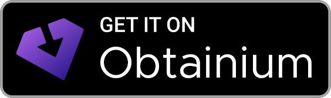
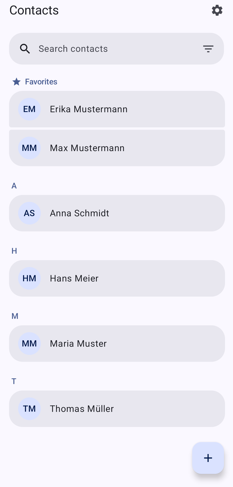
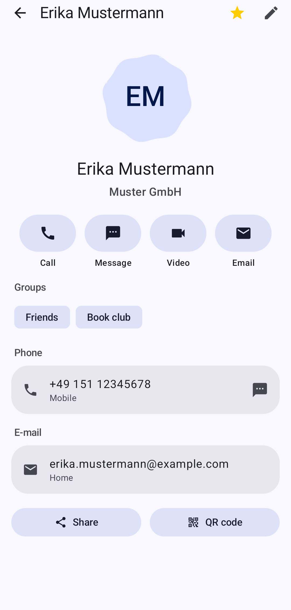
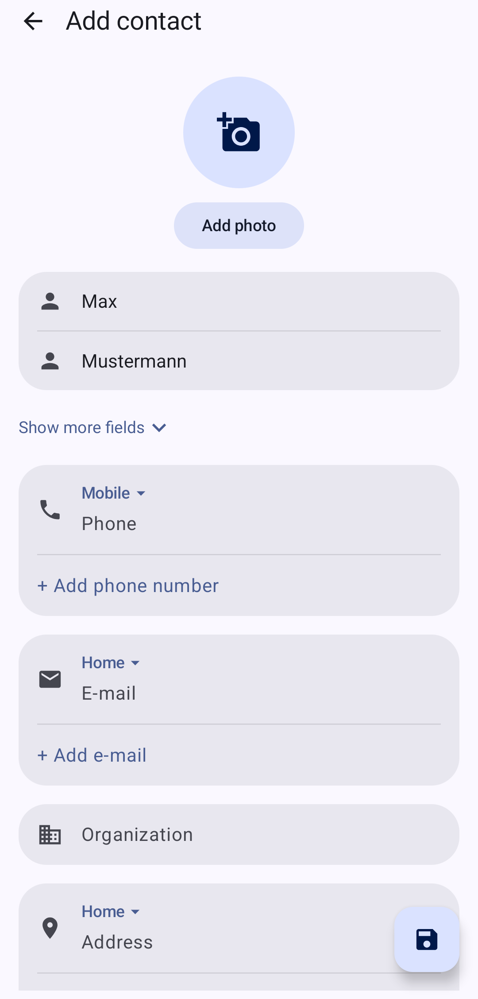

<p align="center">
  
</p>

<h1 align="center">Contacts for Nextcloud</h1>

<p align="center">
A contacts app for a Nextcloud server. It syncs an address book over CardDAV.<br>
It is an unofficial Nextcloud Contacts app.
</p>

<p align="center">
  <a href="https://github.com/LukasSor/Contacts-for-Nextcloud/blob/main/LICENSE"></a>
  <a href="https://github.com/LukasSor/Contacts-for-Nextcloud"></a>
  <a href="https://github.com/LukasSor/Contacts-for-Nextcloud"></a>
  <a href="https://github.com/LukasSor/Contacts-for-Nextcloud"></a>
  <a href="https://github.com/LukasSor/Contacts-for-Nextcloud/commits/main"></a>
</p>

<p align="center">
  <a href="https://github.com/LukasSor/Contacts-for-Nextcloud/releases"></a>
  <a href="https://apps.obtainium.imranr.dev/redirect?r=obtainium://app/%7B%22id%22%3A%22com.nextcloud.contacts%22%2C%22url%22%3A%22https%3A%2F%2Fgithub.com%2FLukasSor%2FContacts-for-Nextcloud%22%2C%22author%22%3A%22LukasSor%22%2C%22name%22%3A%22Contacts%20for%20Nextcloud%22%7D"></a>
</p>

## Features

- Syncs an address book with Nextcloud over CardDAV
- Works with the Android contacts system
- Material 3
- Edit contacts, groups, and favorites
- Open Nextcloud Talk, and use other apps already on the phone
- Put birthdays, anniversaries, and dates of death on a calendar
- Import and export contacts

## Screenshots

<p align="center">
  
  &nbsp;
  
  &nbsp;
  
</p>

## Privacy

Contacts go to the Nextcloud server you sign in to. A copy of the address book stays on the phone, and so does the login.

Website logos are on unless you turn them off. The app then loads the icon from that website. Address suggestions are also on unless you turn them off. The text you type is sent to a Photon server. The default is `https://photon.komoot.io`. You can set another server in settings.

The app asks for contacts permission to use the phone address book and linked apps, phone permission to place a call, and calendar permission to write dates to the phone calendar.

The app has no analytics library.

## Build

Android 8.0 (API 26) or newer. Open the project in Android Studio, or run:

```bash
./gradlew assembleDebug
```

Build output is written outside the project folder, under `nextcloud-contacts-build/` in `%LOCALAPPDATA%`, `$XDG_CACHE_HOME`, or `~/.cache`.

## Contributing

Issues and pull requests are welcome.

Translations are the `values-*` string files under `app/src/main/res`.

## License

The app is under the GNU Affero General Public License v3.0 or later.

See the [LICENSE](LICENSE) file.
